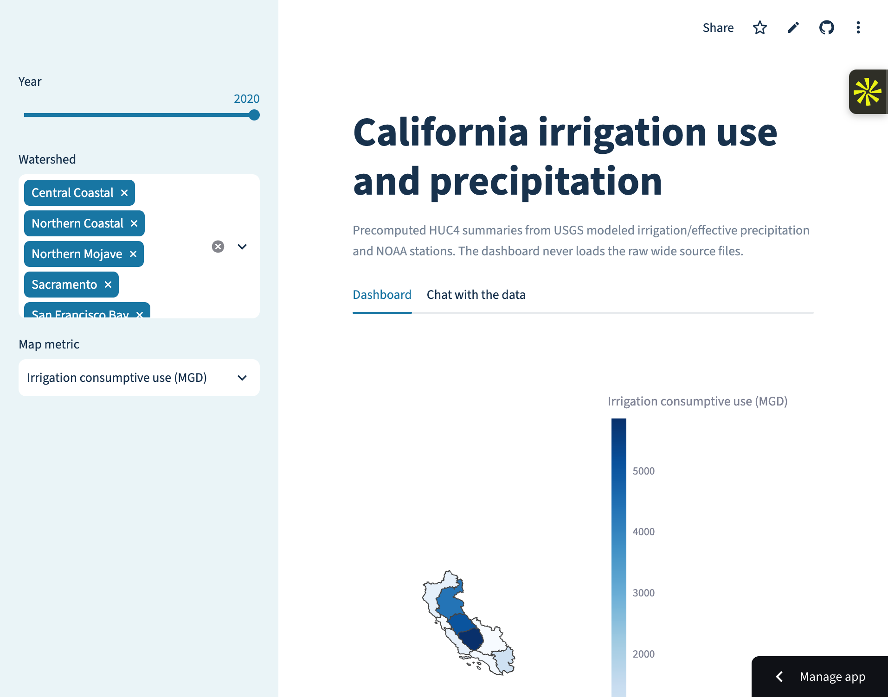
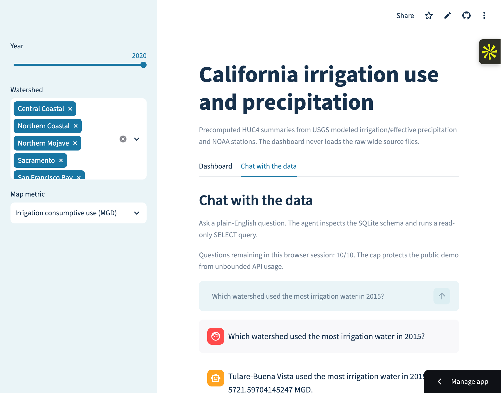

# California Water Analysis

**A reproducible California water-data pipeline and read-only text-to-SQL agent spanning irrigation, precipitation, drought, and policy from 2000–2020.**

[Live dashboard](https://california-water-analysis.streamlit.app/) · [Methodology and statistical results](docs/METHODOLOGY.md) · [Data sources](DATA_SOURCES.md)

| Dashboard | Chat with the data |
| --- | --- |
|  |  |

## Key results

- Improved held-out text-to-SQL execution accuracy from **70% to 85%** at about **$0.002/question** (`$0.002274` in the recorded final run).
- Built a validated panel across **1,169 watersheds and 24,549 watershed-year observations**.
- Validated source identity across **32,924 matched unit-years**, catching both a mislabeled irrigation file and a date misalignment in the original analysis.
- Enforced a read-only SQLite connection, `SELECT`/`WITH ... SELECT`-only queries, a 100-row result cap, SQLite authorizer protections, and one error-repair attempt.

## How it works

```text
USGS + NOAA source files
          │
          ▼
validation and reproducible cleaning ──► SQLite + compact dashboard extracts
                                                   │
                         ┌─────────────────────────┴──────────────────────┐
                         ▼                                                ▼
                 Streamlit dashboard                          LLM tool-calling agent
                                                             schema → SQL → read-only query
                                                                       │
                                                                       ▼
                                                         answer + SQL + result table
```

The build pipeline checks sentinel values, source identity, year coverage, geography, and row counts before producing the analytical panel. The chat agent receives a plain-English schema guide, generates SQL through the OpenAI Responses API, executes only approved read-only queries, and returns a short answer alongside the exact SQL and rows used.

The 40-question benchmark contains equal groups of simple lookups, aggregations, year comparisons, and multi-table joins. It was split into 20 development and 20 held-out questions; the final configuration was selected using development results, then run on the held-out set once. The recorded outcomes are in [`results/agent_heldout_comparison.csv`](results/agent_heldout_comparison.csv) and [`results/agent_final_test.csv`](results/agent_final_test.csv).

## Run locally

```bash
git clone https://github.com/youssefabdelhafez04/california-water-analysis.git
cd california-water-analysis
python -m venv .venv
source .venv/bin/activate
python -m pip install -r requirements.txt
streamlit run streamlit_app.py
```

The dashboard works without an API key. To enable **Chat with the data**, use an environment variable—never commit a key:

```bash
export OPENAI_API_KEY="your-key"
# Optional; defaults to gpt-5-mini
export OPENAI_MODEL="gpt-5-mini"
streamlit run streamlit_app.py
```

For Streamlit Community Cloud, configure `OPENAI_API_KEY` and `CHAT_QUESTION_LIMIT` in app secrets. The public deployment defaults to 10 submitted questions per browser session, including failed calls. Use a dedicated OpenAI project key with a small budget and restrictive rate limits.

To rebuild every dataset, model result, and figure from the public raw sources, download the files listed in [`DATA_SOURCES.md`](DATA_SOURCES.md), place them in the project root, and run:

```bash
python -m water_policy.build_data_product
python -m pytest
```

Large raw source files are intentionally excluded from Git. The repository includes the compact SQLite database and dashboard extracts required by the deployed app.

## Analysis and reproducibility

The full report—including the pre-specified irrigation-response analysis, the earlier 2018-policy analysis, the original-correlation audit, robustness results, and limitations—is in [`docs/METHODOLOGY.md`](docs/METHODOLOGY.md).

The original notebooks, figures, and class documentation are preserved separately in [`original_class_project/`](original_class_project/README.md). They are not used by the production pipeline or deployed dashboard.

## Repository map

```text
water_policy/              reproducible pipeline, agent, safety, and evaluation code
tests/                     analysis, data-product, agent, and SQL-safety tests
evaluation/                40-question benchmark and fixed dev/test split
results/                   generated tables, figures, compact SQLite database
docs/METHODOLOGY.md        statistical methods, audits, results, and limitations
original_class_project/    starting notebooks and class-project artifacts
streamlit_app.py           dashboard and chat UI
```

## Agent evaluation details

With split seed `20261009`, the baseline scored **14/20 (70.0%)** and the final schema-guide agent scored **17/20 (85.0%)** on the held-out questions. Final accuracy by type was **4/5 simple lookup**, **4/5 aggregation**, **4/5 year comparison**, and **5/5 multi-table join**. The measured final cost was **$0.002274/question**; its three failures were logged as two wrong aggregations and one other result mismatch. No placeholder or estimated scores are reported.

Development summaries are in [`results/agent_dev_summary.csv`](results/agent_dev_summary.csv). The one-time held-out run is in [`results/agent_final_test.csv`](results/agent_final_test.csv), and the baseline/final comparison is in [`results/agent_heldout_comparison.csv`](results/agent_heldout_comparison.csv).

## License

[MIT](LICENSE)
