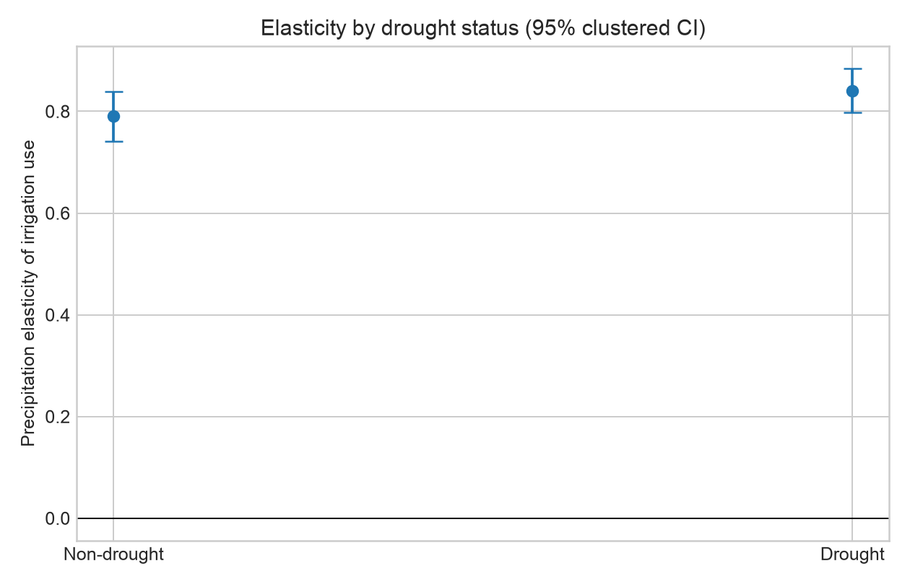

# California Water Analysis

**A reproducible 2000–2020 analysis of irrigation, precipitation, drought, and water policy across 1,169 California watersheds—with a read-only LLM agent for asking questions in plain English.**

Python · SQLite · Streamlit · OpenAI tool calling · USGS · NOAA

**Live dashboard:** [california-water-analysis.streamlit.app](https://california-water-analysis.streamlit.app/)

## Project snapshot

- Builds a validated balanced panel of **1,169 HUC12 watersheds and 24,549 watershed-year observations** from USGS modeled water data.
- Reports a pre-specified precipitation elasticity, drought interaction, robustness grid, source-identity audit, and held-out prediction check without making causal claims.
- Audits an earlier −0.52 correlation and shows exactly which public-supply series and date-alignment bug produced it.
- Evaluates the SQL agent on a stratified 20-question held-out set: **70% baseline accuracy versus 85% final accuracy**, at **$0.002274 per final question** in the recorded run.
- Enforces read-only SQLite, SELECT-only SQL, 100-row results, one error repair, paced rate-limit retries, and a configurable public-demo session cap.



## Build and explore the data product

Place the raw USGS wide files, the NOAA station CSVs, and `b7974dff79ff41f0bd3cd4d8f248c6f4.json` in the project directory. Then run the entire cleaning, storage, analysis, chart, dashboard-extract, and documentation workflow with one command:

```bash
python -m pip install -r requirements.txt
python -m water_policy.build_data_product
```

The command rebuilds `results/water_analysis.sqlite`, every analysis CSV and PNG, the compact dashboard files, and all generated README numbers. The SQLite database contains cleaned HUC12 annual irrigation data, HUC4 annual category data, dashboard summaries, model results, and the original-correlation audit. `results/data_product_manifest.json` records table row counts.

Run the dashboard locally with:

```bash
streamlit run streamlit_app.py
```

The dashboard tab reads the compact dashboard extracts. The **Chat with the data** tab reads
`results/water_analysis.sqlite` through a read-only connection and uses the OpenAI Responses API
with tool calling. Set the API key in the environment (never in source control), then start Streamlit:

```bash
export OPENAI_API_KEY="your-key"
# Optional; defaults to gpt-5-mini
export OPENAI_MODEL="gpt-5-mini"
streamlit run streamlit_app.py
```

The public app accepts `OPENAI_API_KEY` and `CHAT_QUESTION_LIMIT` from Streamlit secrets. The
default session cap is 10 submitted questions, including failed calls. For local secret-file use,
copy `.streamlit/secrets.toml.example` to the ignored `.streamlit/secrets.toml` and replace the
example value. Use a dedicated OpenAI project key with a low monthly project budget and restrictive
rate limits; do not reuse a personal or previously exposed key.

The SQL tool accepts one `SELECT`/`WITH ... SELECT` statement, applies a hard 100-row limit,
opens SQLite in read-only/query-only mode, and installs a SQLite authorizer that denies writes and
schema changes. A failed query is returned to the model for one repair attempt. The UI shows the
plain-English answer, SQL, and result table. Questions the database cannot answer return a clear
error rather than a guessed response.

## Agent evaluation

`evaluation/questions.json` contains 40 hand-authored questions: 10 simple lookups, 10
aggregations, 10 year comparisons, and 10 multi-table joins. Each includes reference SQL. Generate
the directly executed ground-truth results without making API calls with:

```bash
python -m water_policy.evaluate_agent --ground-truth-only
```

With `OPENAI_API_KEY` set, run the real agent evaluation with:

```bash
python -m water_policy.evaluate_agent
```

The evaluator compares the agent query's returned values with the reference query's returned
values (execution accuracy), uses numeric tolerance only for floating-point representation, reports
overall and per-type accuracy, classifies failures as wrong table, filter, aggregation, query error,
or other mismatch, and atomically writes `results/agent_eval.csv`. It also replaces the generated
results block in this README. No score is written unless all 40 live agent runs complete.

The large raw source files are intentionally ignored by Git. The compact 7.5 MB SQLite deployment
database is explicitly included for Streamlit; the large raw CSVs and reproducible HUC12 analytical
extracts remain ignored. See [`DATA_SOURCES.md`](DATA_SOURCES.md)
for original public download sources and exact expected filenames. Run the tests with
`python -m pytest`.

## Pre-specified irrigation-response analysis

This section defines the analysis before the valid irrigation-response models are run. The script stores a SHA-256 digest of this specification in `results/irrigation_run_config.json`; the model grid is fixed here and is not selected using significance. A source-validation run initially treated the ambiguously named local `Irrigation_wateruse.csv` as irrigation use. An identity check showed that file is total crop evapotranspiration: subtracting effective precipitation reproduces the explicit monthly irrigation-consumptive-use series. That run was invalidated before reporting. This amended specification fixes the outcome source below and is frozen under a new digest before re-estimation.

### Question, source data, and sample

The primary question is: **within a subwatershed, how strongly is modeled irrigation consumptive use associated with changes in effective precipitation, and does that association differ in drought years?**

The original files contain irrigation consumptive use and effective precipitation for 4,335 HUC12 columns located in the nine California HUC4 regions used by this project. HUC12 is finer than county geography. The [USGS data release](https://water.usgs.gov/catalog/datasets/649711fe-637f-4cc0-9020-09a21e691d88/) covers all CONUS HUC12 subwatersheds from 2000–2020 and describes the satellite, irrigated-land, and National Hydrologic Model workflow. The local files contain 1,169 HUC12 units with strictly positive irrigation and effective precipitation in all 21 years; this balanced panel is the primary sample. Values coded `999` are missing and are never analyzed. A pre-specified unbalanced robustness sample retains units with at least 15 positive paired years.

`Irr_CU_HUC12_Tot_monthly_2000_2020.csv` is monthly mean crop-irrigation consumptive use in MGD. It is annualized using calendar-day weights, matching the USGS annual-mean definition. `PPTeff_HUC12_Tot_annual_2000_2020.csv` is annual effective precipitation over irrigated land, also represented as an MGD-equivalent flow. The ambiguously named `Irrigation_wateruse.csv` is not used as the outcome because the source identity check shows it contains total crop evapotranspiration. The NOAA files available locally contain three daily stations for each of only nine HUC4 regions, not county or HUC12 weather. Their annual HUC4 temperature averages are assigned to contained HUC12s as a coarse control. No finer temperature series is imputed or invented.

USGS defines consumptive use as crop evapotranspiration supplied by irrigation rather than rain or snow. Both consumptive use and effective precipitation are separated inside the same modeled soil-water balance. Consequently, the analysis estimates a **modeled physical association** and cannot identify a behavioral or causal response by farmers.

### Primary elasticity model

The primary sample spans 2000–2020. The pre-specified log-log panel regression is:

```text
log(irrigation consumptive use MGD)
  = beta × log(effective precipitation MGD)
  + temperature
  + HUC12 fixed effects + year fixed effects + error
```

`beta` is reported as the precipitation elasticity: the percent change in irrigation consumptive use associated with a 1% change in effective precipitation within the same HUC12, conditional on statewide year shocks and coarse regional temperature. Fixed effects are removed by alternating projections. Standard errors use a finite-sample CR1 correction, are clustered by HUC12, and confidence intervals use a t distribution with clusters minus one degrees of freedom. The sign, estimate, clustered SE, 95% CI, and p-value are reported regardless of significance.

### Drought definition and heterogeneous response

The primary drought measure is a 12-month standardized effective-precipitation index. For each HUC12, a zero-location gamma distribution is fit to its 2000–2020 positive annual effective-precipitation values, the fitted cumulative probabilities are transformed to standard-normal scores, and **drought is defined as an index at or below −1.0**. NOAA/NWS uses approximately −1 as the threshold for moderate drought in the [Standardized Precipitation Index classification](https://www.cpc.ncep.noaa.gov/products/Drought/Monitoring/spi.shtml).

Because the available precipitation is modeled effective precipitation rather than an independent meteorological gauge series, the result is labeled an SPI proxy. The heterogeneity regression adds the drought indicator and `log(precipitation) × drought`. The interaction coefficient is the pre-specified test of whether elasticity differs in drought years; both non-drought elasticity and the sum giving drought-year elasticity are reported.

### Out-of-time validation

The predictive model is trained on 2001–2013, with 2000 used only to construct the first lag, and tested once on 2014–2020. It predicts log irrigation use from log effective precipitation, HUC4 temperature, lagged log irrigation use, and regularized HUC12 indicators. Ridge penalty `alpha = 1.0` is fixed in advance. Log predictions are returned to MGD using a training-residual smearing correction. RMSE and MAE are compared with a naive last-observation baseline that predicts each unit's current use from its prior-year use. The 2014–2020 test set is not used to tune the model.

### Fixed robustness grid

The following specifications are run once and all are reported:

1. Alternative drought cutoffs: index ≤ −0.8 and index ≤ −1.5.
2. A nonparametric drought definition: effective precipitation at or below each HUC12's 20th percentile.
3. Drop HUC12 units in the top 1% of unit-level mean irrigation use, with the cutoff computed once on the full primary period.
4. Alternative estimation windows: 2000–2017 and 2005–2020.
5. The unbalanced sample requiring at least 15 positive paired years.

No specification is promoted or discarded based on its p-value.

<!-- IRRIGATION_RESULTS_START -->
## Irrigation-response results

The source audit found **4,335 HUC12 columns** in the nine California HUC4 regions. The primary balanced-positive sample contains **1,169 HUC12 units and 24,549 unit-year observations** from 2000–2020. The source-identity check covers **32,924 matched unit-years** and reproduces annualized monthly irrigation as `Irrigation_wateruse − PPTeff` with maximum absolute discrepancy **0.000062 MGD**, confirming that the ambiguous annual file is total crop ET rather than irrigation consumptive use.

The estimated precipitation elasticity is **0.745** (HUC12-clustered SE **0.024**, 95% CI **0.698 to 0.792**, p = **1.86e-154**). Thus, within this modeled panel, a 1% increase in effective precipitation is associated with a **0.745% increase** in irrigation consumptive use, conditional on HUC12 and year fixed effects and HUC4 temperature.

Under the pre-specified SPI-proxy ≤ −1.0 definition, there are **3,929 drought observations** and **20,620 non-drought observations**. Raw mean irrigation is **16.318 MGD** in drought observations versus **13.140 MGD** otherwise, but this composition-sensitive comparison reverses after scaling each observation by its own unit mean: **0.918** in drought versus **1.016** otherwise. Estimated elasticity is **0.790** outside drought (95% CI **0.741 to 0.840**) and **0.841** during drought (95% CI **0.797 to 0.884**). The drought-minus-non-drought elasticity difference is **0.050** (95% CI **0.039 to 0.062**, p = **1.04e-16**).

For 2014–2020 out-of-time validation, the pre-specified ridge model has RMSE **5.046 MGD** and MAE **2.078 MGD**. The naive last-year baseline has RMSE **3.899 MGD** and MAE **1.758 MGD**. The model does not beat the naive baseline on both level-error metrics.

Across the full pre-specified robustness grid, the overall elasticity ranges from **0.625** (`window_2000_2017`) to **0.810** (`unbalanced_at_least_15_years`). Every requested specification is retained in `results/irrigation_robustness.csv` regardless of significance.

These estimates are descriptive associations within USGS model output. The positive sign does **not** establish that additional rainfall causes farmers to irrigate more: both total quantities can rise with time-varying irrigated extent, and effective precipitation and irrigation consumptive use are jointly separated by the same soil-water-balance procedure. The HUC12 selection follows the nine hydrologic regions and is not a county-boundary or exact California-state-boundary clip. These results must not be presented as causal behavioral elasticities.
<!-- IRRIGATION_RESULTS_END -->

<!-- CORRELATION_AUDIT_START -->
## Original correlation audit

The original **−0.52** was **not an irrigation correlation** and did not use `Irrigation_wateruse.csv`. Notebook cell 13 correlates San Joaquin HUC4 (`1804`) monthly public-supply use from `PS_HUC12_Tot_2000_2020.csv` with mean NOAA `PRCP (Inches)` from `Mercer.csv`, `Sanora.csv`, and `West_Point.csv`. Its exact Pearson correlation is **-0.517739693**. The notebook's rainfall loop inserts a leading zero month and omits December 2020.

Using the same legacy rainfall vector with the actual irrigation-consumptive-use series from `Irr_CU_HUC12_Tot_monthly_2000_2020.csv` gives **-0.459764133**. Correctly aligning rainfall to calendar months gives **-0.672069975**. All three auditable inputs and outputs are saved in `results/correlation_audit.csv`.
<!-- CORRELATION_AUDIT_END -->

## Previous 2018-policy analysis

This project turns the original 2000–2020 HUC12 monthly consumptive-use files and NOAA daily station files into a reproducible annual panel for nine California HUC4 watersheds. It measures how observed water use changed around California's 2018 water-conservation legislation, while separating descriptive evidence from causal claims.

## Reproduce only the previous policy analysis

From this directory, install the dependencies and run:

```bash
python -m pip install -r requirements.txt
python -m water_policy.pipeline
python -m pytest
```

The default comparison is 2014–2017 versus 2018–2020. The windows are inclusive and configurable:

```bash
python -m water_policy.pipeline \
  --pre-start 2013 --pre-end 2017 \
  --post-start 2018 --post-end 2020
```

Each run rewrites the generated results section below from the output CSVs. It also records the exact window and random seed in `results/run_config.json`.

## Data construction

- `Irr_CU_HUC12_Tot_monthly_2000_2020.csv` contains irrigation consumptive use and `PS_HUC12_Tot_2000_2020.csv` contains public-supply use, both in millions of gallons per day (MGD). The pipeline selects California HUC12 columns, treats the documented `999` sentinel as missing, sums HUC12 values to HUC4 within each month, and averages the 12 monthly totals within each year.
- Three NOAA stations represent each HUC4. Annual station precipitation is the daily sum adjusted for observed-day coverage; station-years below 70% coverage are excluded. Annual temperature uses TAVG when available and the TMAX/TMIN midpoint otherwise. The regional value is the unweighted mean across usable stations. Station counts are retained in `annual_panel.csv`.
- `annual_panel.csv` is the auditable watershed × year × category panel used by every model. The original notebook and source data are left unchanged.

## Methods

### Before/after and rainfall adjustment

For every watershed, the pipeline reports the pre-window and post-window means, the absolute MGD change, and the percentage change. A watershed must contain every requested year in both windows. Uncertainty for the median percentage change is a fixed-seed, 20,000-resample percentile bootstrap that resamples watersheds, the independent geographic unit available here.

For rainfall adjustment, a separate OLS model, `total use = intercept + precipitation`, is fit for each watershed on all years before 2018. The adjusted post-policy change is mean observed 2018–2020 use minus mean use predicted under the actual 2018–2020 rainfall; the percentage uses predicted post-policy use as its denominator. This is a weather-adjusted anomaly, not a causal policy effect.

### Treatment rule and exploratory difference-in-differences

California's [Department of Water Resources describes SB 606 and AB 1668](https://water.ca.gov/Programs/Water-Use-And-Efficiency/2018-Water-Conservation-Legislation) as a statewide framework that covers urban efficiency as well as agricultural efficiency and drought planning. Its [urban standards program](https://water.ca.gov/Programs/Water-Use-And-Efficiency/2018-Water-Conservation-Legislation/Urban-Water-Use-Efficiency-Standards-Variances-and-Performance-Measures) specifically defines objectives for urban retail water suppliers. The rule is therefore fixed before looking at outcomes: **public supply is the more directly affected category (`treated = 1`) and irrigation is the less directly affected category (`treated = 0`)**. This is relative exposure, not treated versus wholly untreated: the legislation also contains agricultural provisions. Unknown categories raise an error rather than being silently classified.

This split is useful as an exploratory contrast, but it is not a credible untreated control: the laws are statewide, agriculture and public supply can follow different trends, and other contemporaneous changes may affect either category. The DiD estimate must therefore remain correlational.

The primary level regression is:

```text
annual MGD = public_supply × post_2018
           + precipitation + temperature
           + watershed-category fixed effects + year fixed effects
```

Standard errors are clustered by watershed. There are only nine clusters, so the confidence interval and p-value are fragile. The event study replaces the single interaction with public-supply × year indicators, omits 2017, and plots all yearly estimates. To avoid a rank-deficient test with only nine clusters, the formal pre-trend diagnostic jointly tests the seven recent pre-period coefficients for 2010–2016. The trends chart indexes each category's mean watershed use to 100 in 2017 so scale differences do not hide trend differences.

### Robustness and prediction

- The placebo uses only 2000–2017 observations and assigns a fake 2015 policy date.
- DiD sensitivity uses 2010, 2012, and 2014 starting years. A separate specification drops years in the bottom decile of statewide mean precipitation, with the selected years written to the CSV rather than chosen manually.
- Raw before/after sensitivity varies the pre-window start among 2012, 2014, and 2015.
- The prediction baseline fits ridge regression to irrigation use in 2000–2013 using precipitation, temperature, lagged use, and watershed indicators. It is evaluated only on 2014–2017 and compared with the prior year's use. No post-policy observations are used for training or evaluation.

## Outputs

CSV results and PNG charts are written to `results/`. Key files are `watershed_before_after.csv`, `before_after_summary.csv`, `did_results.csv`, `event_study.csv`, `placebo_2015.csv`, `robustness.csv`, `prediction_metrics.csv`, and `annual_panel.csv`.

<!-- GENERATED_RESULTS_START -->
## Results from the reproducible run

The default 2014-2017 versus 2018-2020 comparison covers 9 watersheds. Median raw use changed by **2.70%** (watershed bootstrap 95% CI **-0.69% to 20.02%**); 2 watersheds decreased and 7 increased. The largest decrease was **Central Coastal (-7.80%)**, while the largest increase was **San Francisco Bay (20.69%)**. After projecting each watershed's post-2018 precipitation through its own pre-2018 use-on-rainfall regression, the median post-policy anomaly was **8.71%** (95% bootstrap CI **-0.69% to 18.29%**).

The exploratory category DiD estimate is **-124.97 MGD** (watershed-clustered SE **63.28**, 95% CI **-248.99 to -0.94**, p = **0.0483**; 9 clusters). The rank-valid joint test of the 2010–2016 event-study pre-period coefficients has p = **1.08e-07**, contradicting parallel trends at conventional levels. The 2015 placebo estimate is **-51.78 MGD** (95% CI **-102.86 to -0.69**, p = **0.047**). The placebo is statistically distinguishable from zero at the 5% level, so this falsification check fails. Dropping the data-defined bottom precipitation-decile years (2007;2013;2020) gives a DiD estimate of **-99.78 MGD** (95% CI **-211.34 to 11.77**).

On the strictly pre-policy holdout (train 2000–2013; test 2014–2017), the precipitation/temperature/lagged-use ridge model has RMSE **168.13 MGD** and MAE **114.29 MGD**. The naive last-year baseline has RMSE **168.35 MGD** and MAE **104.49 MGD**. The ridge model does not unambiguously beat the naive baseline across both error metrics.

These before/after, residual, and prediction results are associational. The DiD is also **not interpreted as causal**: both categories are statewide, irrigation is not a true untreated control, category-specific trends may differ, the pre-trend diagnostic is informative but not proof, and nine watershed clusters make cluster-robust inference fragile.
<!-- GENERATED_RESULTS_END -->

## Limitations

The nine HUC4 watersheds are aggregates, not individual water agencies or households. Three stations cannot capture all within-watershed climate variation, precipitation coverage adjustment assumes missing days resemble observed days, and temperature is averaged from available stations. Water use is estimated rather than directly metered everywhere. The short three-year post period includes only 2018–2020, and 2020 may contain pandemic-related behavioral changes. Percentage changes can also be sensitive to small baselines.

Most importantly, a statewide law supplies no untreated California watershed. The public-supply-versus-irrigation contrast does not make the parallel-trends assumption automatically plausible, and the event study and placebo can reveal problems but cannot validate the assumption. Report the before/after results as descriptive, the rainfall residuals as model-adjusted associations, and the DiD as exploratory rather than causal.

<!-- AGENT_EVAL_START -->
## Chat-with-the-data agent evaluation

The benchmark was split with seed `20261009` into 20 development questions and 20 held-out
questions, with five questions of each type in each split. Only development results were used to
choose the final configuration. The four examples in the prompt are separate from all 40 benchmark
questions.

Development configurations actually run before the remaining experiments were skipped to conserve
requests:

- `baseline` (`gpt-5-mini`, `default`): **7/20 (35.0%)**, **$0.002571/question**
- `schema_guide` (`gpt-5-mini`, `default`): **17/20 (85.0%)**, **$0.002276/question**

The selected final configuration is `schema_guide` using `gpt-5-mini`.
On the held-out questions, baseline accuracy from the pre-split archived run was
**14/20 (70.0%)**;
the final agent's one test run scored **17/20
(85.0%)**.

- `simple_lookup`: baseline **5/5 (100.0%)**; final **4/5 (80.0%)**
- `aggregation`: baseline **4/5 (80.0%)**; final **4/5 (80.0%)**
- `year_comparison`: baseline **2/5 (40.0%)**; final **4/5 (80.0%)**
- `multi_table_join`: baseline **3/5 (60.0%)**; final **5/5 (100.0%)**

Measured baseline cost on the development set was
**$0.002571/question**. Measured final-agent cost on the
held-out set was **$0.002274/question**. Costs use recorded API tokens and the standard
short-context rates published at https://developers.openai.com/api/docs/pricing on 2026-10-09.
The final run's failure log contains: **other result mismatch: 1, wrong aggregation: 2**.

Development summaries are in `results/agent_dev_summary.csv`; the one-time final test is in
`results/agent_final_test.csv`; and baseline/final held-out outcomes are in
`results/agent_heldout_comparison.csv`.
<!-- AGENT_EVAL_END -->
